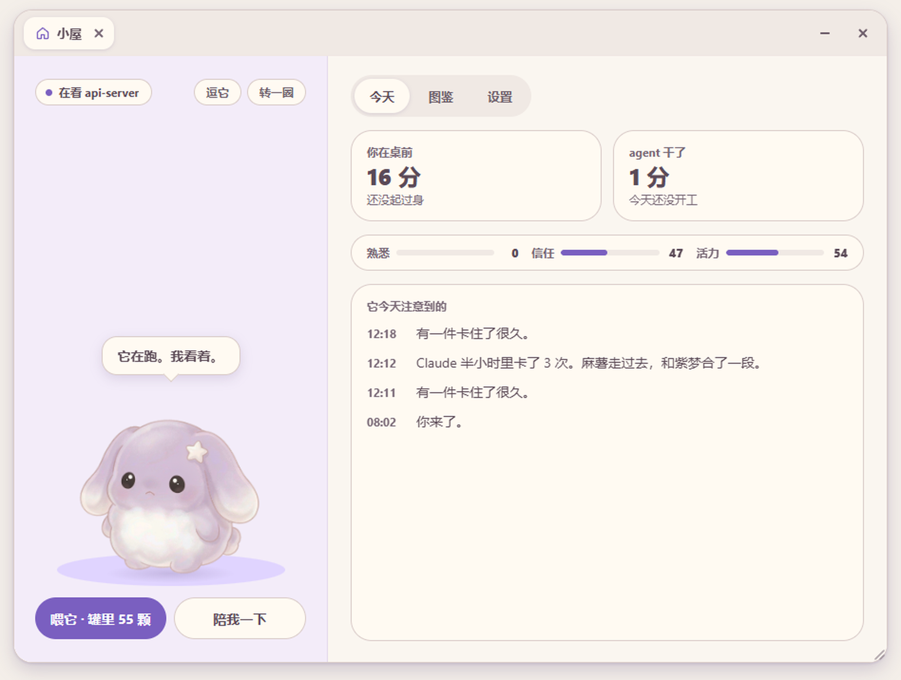
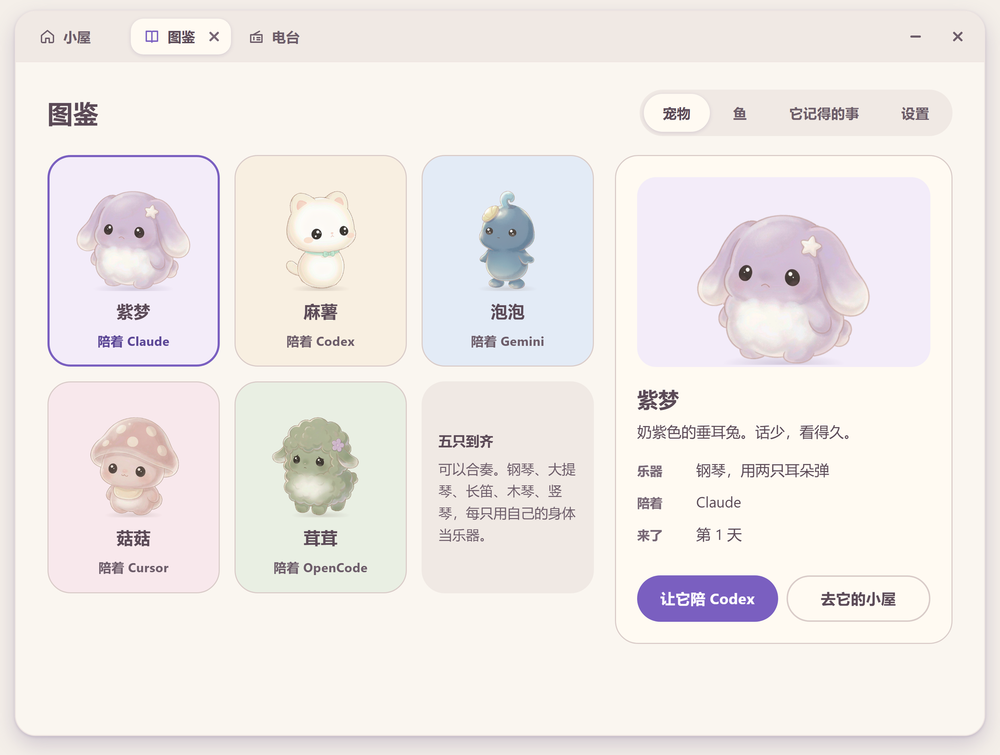

# RillBuddy

[中文](README.zh-CN.md)

RillBuddy (Rill for short; 睿洱 in Chinese) keeps pets on your desktop and has them watch your coding agents for you: Zimeng (紫梦) with Claude Code, Mashu (麻薯) with Codex, and Paopao, Gugu and Rongrong with the experimentally supported Gemini CLI, Cursor and OpenCode. Thinking, working, stopped and waiting for you, done, failed: a pet sees each, and its face and the line over its head tell you. It watches you too. Sit too long, stay up late, or have the agent get stuck again and again, and it does something about it on its own: a dance, a piece on its own instrument, a kegel set done together. With no agent running, Zimeng alone stays on the desktop.

It runs entirely on your machine. Windows 10/11 only. Built with Rust, Tauri 2 and TypeScript/Canvas.



## Contents

- [What it does](#what-it-does)
- [Quick start](#quick-start)
- [Using it](#using-it)
- [Configuration](#configuration)
- [Building from source](#building-from-source)
- [Layout](#layout)
- [Privacy and security](#privacy-and-security)
- [FAQ](#faq)
- [License and assets](#license-and-assets)

## What it does

### It watches the agents for you

- **One pet per agent**, each a different one: Zimeng for Claude Code, Mashu for Codex, Paopao for Gemini CLI, Gugu for Cursor, Rongrong for OpenCode (change this in the gallery). The tag under its feet says whose it is and which project it is watching (`Claude · my-project`); several sessions of the same agent show as a number at its corner. When an agent's last session closes its pet goes home, and with no agent open only Zimeng is on the desktop.
- **Read the face.** It watches while the agent works, hops when a turn ends well, frowns at a failure, gets drowsy with nothing to do, and sleeps when it sleeps.
- **Waiting for you is the loud one.** When the agent stops for your answer or approval, it looks up at once, a coral "Waiting on you." appears over its head, and two piano notes sound. Nothing else in the app uses that colour.
- **Hover for a second** for the session card: project, state, how long it has run, the last tool. **Double-click** to bring that session's terminal or IDE to the front. The card sits above the pet, or beside it when there is no room above, never over it.
- **In hand.** Right-click, Keep me company → Write something down: type one line in the bubble over its head and press Enter; with text selected, `Ctrl+Alt+N` starts from that text. While it holds something for you, a slip of paper is pinned at its side (no number). The session card lists these under the sessions: tick one and it balls up the slip and eats it; tick again to put it back. A line like "when Claude is done…" waits: once Claude's turn stops and you are at the desk, Claude's pet brings it up, and Yes takes you to that window. The "Next step: …" line an agent ends its session with becomes a slip by itself (at most 4 open per agent); nothing else of its reply is read. What is left from yesterday comes up the next morning, in the same line as the night's tidy.
- **Approve permissions on the pet** (optional, off by default): when Claude Code asks for permission, a card opens above the pet; click Allow or Deny without going back to the terminal. See [Approving permissions on the pet](#approving-permissions-on-the-pet).
- **Quota.** Under More in the right-click menu: Codex's 5-hour and weekly limits, and Claude Code's once its status line is hooked up. It says so at 90%.

### It watches you, too

It reads one thing about you: how long since the keyboard or mouse was last touched (not what you typed, not what is on the screen). From that it recognises a few situations, answers each with one act, and says what it noticed first:

| It notices | It does |
|---|---|
| You have sat for 90 minutes straight (60 between 1 and 4 pm) | Dances, or turns its back and leads a kegel set; the two take turns |
| It is past 11 pm and you are still here | Plays a piece on its own instrument |
| An agent got stuck 3 times in half an hour | That agent's pet plays a piece |
| An agent has waited 3 minutes for you while you sit right there | The other pet walks over and tells you |
| A job that ran 15 minutes or more just finished | Dances |
| You come back after 20 minutes or more, and something finished or failed meanwhile | Tells you what happened |
| An agent has been on one job 8 minutes or more and you have stopped to wait on it | Asks whether to play the radio; "Yes" plays one of your regular stations |
| After 10 pm you have sat for half an hour | Asks if you'd like something quiet; "Yes" plays from the Quiet shelf |
| The agents' sessions older than a month pass 1 GB (once a week at most) | Asks whether to tidy the storeroom; "Yes" opens it |
| You switch to the desktop and several icons are out of their columns (once a day at most) | Asks whether to sweep the desktop; on "Yes" it rides its broom over, sweeps the icons back into the columns and returns. The bubble afterwards offers "Put them back", which undoes it |

A sweep changes only where icons sit; files are never moved or changed. Icons already in a column stay put, and the others go into the next free cells; when most icons are out of place, the whole desktop is sorted by type (system icons and shortcuts keep their order, files go by name). It does not sweep when desktop icons are hidden or Auto arrange is on.

The ones with "Yes" and "Not now" on the bubble are questions: nothing plays unless you say yes. It doesn't ask while the radio is on or in quiet mode, and once asked it lets it be for hours.

Two acts are at least 10 minutes apart. In focus mode, or with chattiness set to quiet, it does nothing on its own. Click it and it stops.

The sound is sampled from real instruments, and each pet has its own instrument and its own way with it: Zimeng plays a row of floating keys with both ears; Mashu bows a cello with its tail; Paopao blows a flute held sideways, and every note leaves the end of it as a bubble; Gugu strikes a small xylophone with two mallets, each bar lighting as it is struck, and the spots on its cap with it; Rongrong plucks a small harp standing beside it with the ear on that side: the plucked string shivers, and notes drift up from it. Each has nine dance moves, one of them a tail wag with its back turned.

### Several together

With two or more agents open there are that many pets on the desktop, and they share these moments:

- **On their first day**, when one plays, the nearest one walks over and the rest listen from where they are. The room's diary notes that the newcomer arrived.
- **From the second day they have spent together**, when one plays, one walks over and everyone there joins in on its own instrument. The five scores are five parts of one piece: two pets are a duet, all five a quintet. They dance together too.
- **One tells you about the other.** When an agent has been waiting for you for over 3 minutes, its own pet is already looking up at you, so the other one walks over and says so. Once per wait.
- **A sweet for the one still at work.** From the second day, when one agent finishes a job of a few minutes while another is still on a long one (or has just got stuck), the finished pet walks over and hands it a sweet from the jar. It really comes out of the jar, the one you see fly in is the kind it was, and the jar always keeps its last sweet for you. At most once in 40 minutes.
- **Finished together, they bump.** Two agents that finish within a minute and a half of each other: the later one's pet walks over, they hop and touch.
- **When nothing needs them, two of them talk.** After about twelve quiet minutes with nobody working, one walks over to another and they say a line each, in their own ways: the light, a sound outside, the jar, an instrument out of tune, hanging off the edge of the screen. Silent bubbles, at most once in an hour and a half; the room's diary keeps what they said.
- The one that walked over goes back to its spot when the piece ends. A pet whose agent is waiting on you does not join in, and a sleeping one is not woken.
- **Carry the main pet and the rest come along.** Press and drag Zimeng (the pet with Claude Code) and the others keep their places beside it, landing with it when you let go. Dragging any other pet moves only that one.

"Play the piano" (the cello, the flute, the xylophone, the harp) and "Dance" in the right-click menu follow the same rules.

### Each pet is a whole skin

A pet is more than a figure. A window wears the skin of the pet it was opened from: the colours of the room, the right-click menu, the letter paper, the radio and the approval card, the mark on the envelope, the two notes of "waiting for you" (on its own instrument), and the way it talks. Zimeng says little and only what it saw; Mashu is clingy and tells you where it was. Windows that belong to no pet (the tray, the gallery, the daily report) follow the pet that is with Claude Code. The gallery is where you change which pet goes with which agent. When you change which pet goes with an agent, the pages already open change their skin with it.

### The room, letters and the rest

All of these open in **one window**, each as a tab: pick a feature and a tab is added, and a tab can be closed. The window draws its own frame, in the colours of the pet whose page is in front. Closing the window only puts it away: the tabs are still there and the radio keeps playing; closing the radio's tab is what stops it. Pull the bottom-right corner to make it bigger; double-click the empty part of the tab bar to fill the screen.

- **The room**: where it sits. On the left, the pet and what it is saying; on the right, today: your time at the desk and the breaks you took, the agents' time, turns and failures, and "what it noticed today", one line for each thing it did on its own. You can play with it here: its eyes and head follow your pointer; a click is a poke, and a few quick ones make it spin itself dizzy; press and drag across it to turn it round and see its back; stroke its head and it shuts its eyes; "Tease it" hangs its own charm from your pointer, and the whole room is its to move in: it runs after the charm along the floor, crouches and jumps for it when it is overhead, and if it gets its mouth on it in the air it holds on, so you can swing it about until it lets go and drops; held too high for its legs, it jumps, misses and says so (each jumps a different height: Mashu highest, Paopao least); "Spin" has it turn once on the spot; "Catch sweets" is the one small game: for thirty seconds sweets of every kind in the catalogue drift down from the top of the room, the pet runs to stand under your pointer and a click makes it jump, and what reaches its mouth it eats. Catch 20 in a round and one goes into the jar (two a day at most).
- **Sweets** are what they eat (sweets and fruit), and they are earned and kept in a jar. Which kind comes depends on the moment: each turn an agent finishes brings one (a failed turn, only an empty wrapper); some turn up only in the morning, the afternoon or at night, and each season has its own; with no agent it is up to you: a kegel set done with the pet earns a salted plum, and getting up for a while after sitting half an hour or more earns a mint leaf, up to 6 a day this way. When the jar is empty the feed button tells you how to earn. Feed the pet and it answers with a line, and now and then says something it has kept to itself.
- **Letters** are about you, not about what you did. Over the days the pet comes to see what kind of person you are from the way your days go: you go quiet and carry it alone when stuck; you keep the quietest hours for the night; what you promise yourself always waits at the back; you never stop to look at something once it is finished. A letter says that one thing it understood, and what it feels about it. There is always a reason to write: a long stuck stretch that finally gave way, several late nights, coming back after days away, something worked on for weeks gone quiet, a note it held for days that you crossed off, a day far fuller than usual, a week, a month or a season of knowing you, and now and then nothing at all. No numbers, no clock times, no names of what you work on, no praise and no advice. At most one every four days, none while one is unopened, and never twice about the same thing.
- **The gallery**: the five pets with their instruments, and which pet goes with which agent; the sweets met so far (22 kinds; one not met yet says when it turns up), what it remembers (the diary across days), and the settings.
- **The daily report**: one card you can copy as an image. It opens by itself at off time (18:00 by default) on days the agents worked; any other time, click the "The agents' day" card in the room.
- **The radio**: stations from all over the world, shelved as regulars, upbeat, quiet, crosstalk and world. It listens along and says what it knows ("First time on this one.").
- **The storeroom** (in the settings, under Language and agents): what your agents keep on this machine. On disk, the session records: Codex keeps every one forever (on a machine in daily use that easily reaches several GB), Claude Code clears its own after a month. Sessions older than 30 days can be packed into one box in Rill's folder (the box is checked before any original goes; the last 30 days are never touched) and put back, dates and all, with one click. And what every new session reads before you say a word: the CLAUDE.md / AGENTS.md files from your home and up the project's folders, the memory index, the text start-up hooks put in, the skills listed for it and the MCP servers it connects to, each with a rough token count, marked where the last month's sessions never used it. Unused skills can be put away in the storeroom (and brought back) from here; for the rest it says what to change and gives the command. Everything is counted locally: nothing is sent and no tokens are spent. Once a week at most, when the old sessions pass 1 GB, the pet mentions it.
- **Bugs**: when an agent's tool fails, bugs drop to the bottom of the screen. The pet runs along the bottom and pounces on them itself, and you can click one first. Three failures in a row bring a big one that pins that pet where it stands; then the other pets come over and swat it from its far side, one swat at a time (a pet on another screen walks over onto this one, and goes back afterwards), and your clicks count too, until it is gone and the pet can move.



### Staying out of the way

- The boss key (`Ctrl+Alt+H`) hides and mutes everything at once; it also hides by itself in fullscreen and while you share your screen in a meeting.
- "Quiet for a while" (focus mode, `Ctrl+Alt+F`) keeps only the status and the "waiting for you" alert.
- It talks only to `127.0.0.1`, with a token. Three things go online, all listed under [Privacy and security](#privacy-and-security): the radio, downloading the local language model, and letter writing when `ANTHROPIC_API_KEY` is set.

## Quick start

### 1. Install

1. Download `RillBuddy_<version>_x64-setup.exe` from the Releases page, or [build it yourself](#building-from-source).
2. Run the installer. It installs for the current user and needs no administrator rights. It is not code-signed yet, so SmartScreen may stop it once; see the [FAQ](#faq).
3. Rill starts when the install finishes and, by default, with Windows (Settings → On this computer → Start with Windows turns that off).
4. On first start Zimeng acts out an agent's states for you, with the hook-up buttons on the same page. To see it again: `/pet tour`.

### 2. Hook up Claude Code

Tray → Settings… → Language and agents → Hook up agents → **Claude Code…**

This runs `claude plugin marketplace add` and `claude plugin install rillbuddy@rillbuddy` for you (the Claude Code CLI must be installed). Restart Claude Code afterwards.

By hand, in a normal terminal:

```
claude plugin marketplace add /path/to/rillbuddy
claude plugin install rillbuddy@rillbuddy
```

With the installer, the marketplace is the `plugin` folder next to `rillbuddy.exe`. Use forward slashes on Windows too (`C:/path/to/rillbuddy`); inside Claude Code's own prompt, `/plugin marketplace add` with backslashes does nothing.

### 3. Hook up Codex

Tray → Settings… → Language and agents → Hook up agents → **Codex…**

This appends Rill's hooks to Codex's `hooks.json`. Your own hooks stay, and the file is backed up first.

**One step you must do by hand:** run `codex` in a terminal, type `/hooks`, and mark Rill's hooks as trusted. Codex only runs trusted hooks. The ChatGPT / Codex desktop app has no `/hooks` command, but it shares the same config folder, so trusting them in the CLI is enough.

Both hook-ups show what they will change first and act only when you confirm.

By hand:

```
rillbuddy-emit --install codex
```

- Writes to `$CODEX_HOME/hooks.json`, or `~/.codex/hooks.json` when `CODEX_HOME` is not set. `--codex-home <dir>` picks another.
- Your hooks are kept as they are; Rill's go last for each event.
- The file is backed up as `hooks.json.rillbuddy-bak` first.
- The emitter is copied to `~/.rillbuddy/bin/`, so moving the repo later breaks nothing.
- Not sure which config folder Codex uses (say `CODEX_HOME` is set and `~/.codex` is in use too)? Install into both: run it again with `--codex-home %USERPROFILE%\.codex`.
- Remove: `rillbuddy-emit --uninstall codex`

### 4. Other agents (experimental)

Gemini CLI, Cursor and OpenCode can each have a pet too. Use the buttons under Gallery → Settings → Other agents, or by hand:

```
rillbuddy-emit --install gemini      # appends hooks in ~/.gemini/settings.json
rillbuddy-emit --install cursor      # appends hooks in ~/.cursor/hooks.json
rillbuddy-emit --install opencode    # writes a plugin to ~/.config/opencode/plugins/rillbuddy.js
```

Swap `--install` for `--uninstall` to remove; add `--config-dir <dir>` when the config is elsewhere. Existing hooks are kept and files backed up first.

- Cursor has no "waiting for the user's approval" hook event, so its pet will not call you.
- **These three adapters follow each vendor's documentation and have not been verified against real Gemini CLI, Cursor or OpenCode installs.** If a field does not match, copy the `mapping.yaml` from [`adapters/`](adapters/) to `~/.rillbuddy/adapters/<name>.yaml` and edit it; no rebuild needed. Issues are welcome.
- Cursor also runs Claude Code's hooks by default. Rill recognises that and does not count Cursor's sessions under the Claude Code pet; hook Cursor up on its own.

That is all. Start a session in any hooked-up agent and its pet comes alive.

## Using it

### Mouse

| Do | What happens |
|---|---|
| Click | A poke. While it performs, a click means "enough" |
| Stroke its head back and forth 3 times | It is pleased |
| More than 12 clicks in 5 s | It says "Enough.", hops away, and ignores you for a minute |
| Press and drag | Move it; let go with speed and it flies, bounces, and gets dizzy if it hits hard. Thrown fast enough at the left, right or top edge of the screen, it sticks there: leaning on a side and sliding slowly down it, or swinging from the top. When it tires, or you click it, or you feed it and it gets heavier, or its agent is waiting for you, it slips off, lands, and walks back to where it was picked up |
| Double-click | Brings the session's terminal or IDE to the front (the one waiting on you first) |
| Hover 1 s | The session card |
| Right-click | The menu |

Pets land on the bottom of the screen or on the title bar of a normal window, and fall when that window moves or closes. Clicks outside the pet's body pass through.

### The right-click menu

Right-click the pet and a card opens beside it. At the top: its name, the agent it stands for, the project it is watching, and how long the agents have worked today. Then:

- **Keep me company**: dance · play the piano (the cello, for Mashu) · radio · a kegel set · write something down
- **Feed it**: with the number left in the jar
- **A letter**: only when one is waiting
- **Room**
- **Quiet for a while**: the focus mode switch
- **More**: feed more · usage or the reset card · hide. (The pages, the gallery and the report among them, are in its room; the switches are in the tray.)

### The tray panel

Click the tray icon. On top, the pets that are here and what each agent is doing; three switches: **Quiet for a while**, **It acts on its own**, **Sound**; the three sizes; **Open the room**, **Hide them all** (the boss key), and quit. Below them, one way on: **Settings…**, where everything else is (chattiness, kegels, language, hooking up agents, the storeroom, auto-start, the local language model, the data folder). Nothing else gets a place of its own in the tray or the right-click menu: a new feature either happens by itself, the pet bringing it up when it matters, or lives in a page that already exists.

Flipping a switch keeps the panel open; click outside it or press Esc to close.

### `/pet` commands (Claude Code)

| Command | Does |
|---|---|
| `/pet show`, `/pet hide` | Show or hide the pets |
| `/pet stats` | The state of each session |
| `/pet focus [on/off]` | Focus mode |
| `/pet size s/m/l` | Pet size |
| `/pet lang auto/zh/en` | Interface language |
| `/pet kegel` | A kegel set with it, now |
| `/pet radio` | Open the radio |
| `/pet moment [share\|bump\|chat\|tidy\|stow]` | Play one of the moments between two pets now, to see it (needs two pets up); `tidy` has one pet ask whether to sweep the desktop; `stow` has it ask whether to put the desktop's old files into the 桌面收纳 folder as it sweeps |
| `/pet report` | Open today's report |
| `/pet menu` | Open the right-click menu |
| `/pet tour` | It acts out an agent's states |

Codex has no such commands; use the tray, the right-click menu or the gallery.

### Settings

Gallery → Settings (tray → Settings…): size, chattiness, quiet for a while, sound, reps per kegel set, language, approving permissions on the pet, hooking up each agent, and Claude Code usage. Changes apply at once and are written to `config.yaml`.

### Approving permissions on the pet

Off by default. Once you turn it on in the settings:

- Each time Claude Code asks for permission, a card opens above the pet: the tool, its own one-line reason, and the command it wants to run (or the file to change, or the address to reach), with three buttons: **Allow**, **Deny**, **Decide in terminal**. It answers this one request and never changes your permission rules.
- The card does not take focus, so the window you are in is not interrupted. Several requests queue up; the card's corner shows how many are left.
- **The cost**: while this is on, the terminal's own prompt waits for the card. With no click, it comes back to the terminal after the time you set (15 / 30 / 60 s, 30 by default); "Decide in terminal" sends it back at once.
- No card in fullscreen, while sharing your screen, or under the boss key: the terminal asks directly.
- The command text is handed to Rill on this machine (it is not forwarded otherwise), only to show the card, and is not stored.
- Claude Code only. Codex's hooks have no way to carry an answer back.
- When it is off, nothing changes from before: the hook returns at once and waits for nothing.

### Hotkeys

| Default | Does |
|---|---|
| `Ctrl+Alt+H` | Boss key: every pet and overlay hides and mutes at once; press again and it peeks back up |
| `Ctrl+Alt+F` | Quiet for a while (focus mode): only the status and the "waiting for you" alert |
| `Ctrl+Alt+N` | Write something down; with text selected first, it starts from that text (read through the system's accessibility interface: no clipboard, never a password box) |

Change them under `hotkeys` in `config.yaml`; they take effect after a restart.

### Hiding by itself

- **Fullscreen**: hidden while the foreground window is fullscreen (video, slides), back 3 s after it ends.
- **Screen sharing**: hidden while the "sharing" toolbar window of Tencent Meeting, Feishu, DingTalk, Zoom, Teams and others is present. If yours is not recognised, add words from that toolbar's window title or class name to `meeting.share_windows` in `config.yaml`.

## Configuration

Runtime data lives in `~/.rillbuddy/`; set `RILLBUDDY_HOME` to move it. Settings → Language and agents → **Edit config…** opens `config.yaml`; changes apply on save.

```yaml
language: auto           # interface language: auto (follows the system) | zh | en

companions:              # which pet goes with which agent (also set in the gallery): zimeng | mashu | paopao | gugu | rongrong
  claude-code: zimeng
  codex: mashu
  gemini: paopao
  cursor: gugu
  opencode: rongrong

features:
  focus_mode: false      # quiet for a while
  sounds: true           # their instruments and the alert notes
  size: m                # s | m | l (0.75× / 1× / 1.35×)
  kegel_reps: 10         # squeezes in one kegel set (3 s on, 3 s off)
  chatter: normal        # how much it says and does on its own: quiet | normal | lively
  approve: false         # answer Claude Code permission requests from a card above the pet
  approve_wait_s: 30     # how long the card waits (seconds) before the terminal asks instead

# meeting:
#   share_windows: ["Sharing"]   # extra words to recognise a meeting app's "sharing" toolbar

hotkeys:
  boss_key: Ctrl+Alt+H
  focus_toggle: Ctrl+Alt+F
  note: Ctrl+Alt+N
```

The settings page and `/pet` commands rewrite this file: keys you added yourself are kept, **comments are not** (a limit of the YAML library). Changes are validated before they are written. Keys left over from earlier versions (routing modes, pet packs and so on) are ignored without an error.

### The data folder

| Path | Holds |
|---|---|
| `config.yaml` | Configuration |
| `token`, `port` | The local API's credential and port |
| `spool/` | Events kept while Rill was not running |
| `windows.json` | Where the pets stand (back to the main screen's corner when a monitor is unplugged) |
| `rillbuddy.db` | Turns, the jar of sweets, squashed bugs, the diary, the bond (SQLite) |
| `balance.yaml`, `treats.yaml` | Optional: override built-in numbers and the kinds of sweets (names, looks, when they turn up); write only the keys you change |
| `interactions/*.yaml` | Optional: your own interaction rules; the same id overrides a built-in one, `enabled: false` turns one off |
| `bin/` | The emitter installed for Codex |
| `logs/petd.log` | The log |

Built-in defaults are in [`crates/petd/assets/`](crates/petd/assets/), with the available fields in the files' comments. Letters you have read are kept on this machine, in the app's own web storage.

## Building from source

You need Rust 1.88+, Node 18+ and WebView2 (part of Windows 10/11).

```bash
cd app && npm install && cd ..
node tools/build.mjs            # release; add --debug for a faster build
```

This builds `target/release/rillbuddy.exe` and copies `rillbuddy-emit` into `adapters/claude-code/bin/`.

For an installer: `node tools/build.mjs --bundle` produces `target/release/bundle/nsis/RillBuddy_<version>_x64-setup.exe`, with the Claude Code plugin and the emitter inside. Tauri downloads NSIS on the first build.

The npm `@tauri-apps/api` version must share its minor version with the Rust Tauri crate (both 2.11 now), or `tauri build` refuses to bundle.

### Running from source

1. Run `rillbuddy.exe` once by hand. It writes its own path to `~/.rillbuddy/petd_path`, and the emitter starts it from there whenever it is not running.
2. Hook up Claude Code with the repo as the marketplace:
   ```
   claude plugin marketplace add /path/to/rillbuddy
   claude plugin install rillbuddy@rillbuddy
   ```
3. Hook up Codex: `adapters\claude-code\bin\rillbuddy-emit.exe --install codex`, then trust the hooks with `/hooks` inside `codex`.

Claude Code copies the plugin to `~/.claude/plugins/cache/`. After a rebuild, change the version in `adapters/claude-code/.claude-plugin/plugin.json`, update the plugin, and restart Claude Code:

```
claude plugin marketplace update rillbuddy
claude plugin update rillbuddy@rillbuddy
```

Tests, debugging and contribution rules are in [CONTRIBUTING.md](CONTRIBUTING.md); implementation notes in [docs/implementation-notes.md](docs/implementation-notes.md).

## Layout

```
crates/emit/              the hook emitter (Rust, one executable), with the installers for each agent
crates/petd/              the daemon core: session state machine, one pet per agent, the world layer
                          (sweets, bugs), the five pets and who goes with whom (cast.rs), what
                          they do on their own and together (think.rs), how each one talks (voice.rs), the
                          bond and letters (bond.rs), config, HTTP/WS, SQLite
crates/petd/assets/       built-in balance.yaml, treats.yaml, interactions.yaml, bond.yaml
app/                      the Tauri 2 shell and the TypeScript/Canvas pages
  index.html              a pet window (one per pet)
  src/rig/                the layered rigs: rig.js (pose, faces and dance moves: the lop-eared body and the upright ones), perform.js (the five instruments' scores, and the dance)
  src/skin.ts voice.ts    each pet's whole skin, and what it says in the windows
  public/rig/<pet>/       each pet's layers (zimeng, mashu, paopao, gugu, rongrong)
  public/audio/<instrument>/  instrument samples (piano, cello, flute, xylophone, harp)
  menu.html tray.html     the right-click menu, the tray panel
  shell.html              the one window the pages open in: its own frame and tab bar, each page a tab
  room.html               the room
  gallery.html            the gallery (pets, sweets, what it remembers, settings)
  letter.html radio.html report.html welcome.html
  card.html approve.html  the hover card, the permission card
  overlay.html            the overlay (one per monitor): bugs
adapters/claude-code/     the Claude Code plugin: hooks/hooks.json, commands/pet.md, bin/
adapters/codex/ gemini/ cursor/ opencode/   each agent's mapping table
design/pet-art/           the five pets' art, the layer-cutting scripts and a preview page (not in the installer)
tools/build.mjs           the build script
docs/                     implementation notes, screenshots
```

How it works: every hook of an agent runs `rillbuddy-emit`, which sends one small event to the local daemon (`petd`, running inside the app) and exits at once, in 300 ms or less (the one exception is a permission request after you turned on approving on the pet, which waits for your click). When the daemon is not running, events go to `spool/` and are replayed on the next start. The pages read state over local HTTP and WebSocket.

## Privacy and security

- **Local only.** The daemon listens on `127.0.0.1` alone (port 47321 by default, a random free one if that is taken), and every request must carry the token in `~/.rillbuddy/token`. Three things go online: (1) with the radio open, it reads the station directory from [Radio Browser](https://www.radio-browser.info/) and plays the station you pick; (2) when you click "Pet language model" in the tray, it downloads a local model of about 390 MB from Hugging Face, for writing letters; (3) when a letter is written and the environment variable `ANTHROPIC_API_KEY` exists, the letter is written by Anthropic's API, which receives the pet's name and temper, why it is writing (such as "a couple of days ago, in the afternoon, something stayed stuck a long time and finally went through") and what it understood about you (such as "when you're stuck you'd rather try once more yourself"), with no code, file names, project names, times or the notes you wrote. Without that variable it uses the local model, or puts a letter together from ones written for each reason and each understanding, and nothing leaves the machine.
- **One number about you.** "How long you have sat" comes from the system's seconds since the last keyboard or mouse input. It reads no keys, takes no screenshots, and does not look at window contents.
- **Events carry only what is needed.** A hook hands the daemon what the pet needs: the session id, the event type, the session's working directory, the tool name, the name of a changed file and the agent's process id. Prompts, file contents and tool output are never forwarded. One exception, which you turn on yourself: approving permissions on the pet hands the command to be approved to Rill on this machine to show the card, and does not store it. Also, when a turn ends, the hook looks in the agent's last reply for the line that says "Next step: …" and hands only that line to the daemon, for 手上的事 (In hand); the rest of the reply is not forwarded.
- **Selected text is read only when you press the key.** On `Ctrl+Alt+N`, the text selected right then is read once through the system's accessibility interface, to start the note with; no clipboard, no simulated keys, never a password box.
- **Hooks are appended, never replaced.** For Claude Code it is an ordinary plugin. For Codex, Gemini CLI and Cursor, Rill's hooks go after yours and the file is backed up first; for OpenCode it is one separate plugin file.
- **Claude Code usage is read-only.** The numbers are what Claude Code gives its status-line command, read only after you click to hook that up; Rill does not sign in to your account or query anything online.
- **Codex quota is read-only.** It reads Codex's own session logs and changes nothing. Rill never uses a reset card for you.
- **Local system information.** To notice closed sessions, jump to a terminal, and hide in fullscreen or while sharing, the app reads this machine's process list and window titles. They are not stored or sent anywhere.

## FAQ

**Windows SmartScreen blocked the installer.**
It is not code-signed yet. Click "More info → Run anyway", or build the installer yourself.

**The Codex pet never moves.**
Codex only runs trusted hooks. Run `codex` in a terminal, type `/hooks`, and trust Rill's. If you use more than one Codex config folder, install into each (see [Hook up Codex](#3-hook-up-codex)).

**After a rebuild Claude Code still runs the old emitter.**
Claude Code runs its cached copy of the plugin. Change the plugin's version, run `claude plugin marketplace update rillbuddy` and `claude plugin update rillbuddy@rillbuddy` (or click Hook up → Claude again; it updates an installed plugin), then restart Claude Code.

**Upgrading from 0.1.33 or earlier.**
The program used to be `familiar.exe`, its data lived in `~/.familiar`, and the Claude Code plugin was `familiar@familiar`. On its first start the new version moves the data to `~/.rillbuddy` and leaves a link at the old place, so old hooks keep working. A pet then asks whether to switch Claude Code over to the new name; say yes and restart Claude Code. Codex hooks are not changed for you (they would have to be trusted again): hook up Codex again from Settings when you want them moved. The link removes itself once nothing uses the old path.

**The pets are gone.**
Check, in order: the boss key (`Ctrl+Alt+H`); a fullscreen window in front; a meeting app sharing the screen; whether you hid them (tray → Bring them back, or `/pet show`).

**Why does it never act on its own?**
See whether "Quiet for a while" is on, or "It acts on its own" is off. It also only moves once you really have sat that long, and never twice within ten minutes.

**It did not hide while I shared my screen.**
Add words from your meeting app's "sharing" toolbar window title or class name to `meeting.share_windows` in `config.yaml`.

**Double-click does not reach the exact tab.**
Windows Terminal can only be brought forward as a window, not by tab.

**Where is the log?**
`~/.rillbuddy/logs/petd.log`.

## License and assets

Code: [MIT](LICENSE).

- **Piano samples**: Salamander Grand Piano by Alexander Holm, [CC BY 3.0](https://creativecommons.org/licenses/by/3.0/); see [`app/public/audio/piano/LICENSE.txt`](app/public/audio/piano/LICENSE.txt).
- **Cello samples**: "Real Cello Notes" by flcellogrl (Freesound), in the edited set from Nicholaus Brosowsky's tonejs-instruments, [CC BY 3.0](https://creativecommons.org/licenses/by/3.0/); see [`app/public/audio/cello/LICENSE.txt`](app/public/audio/cello/LICENSE.txt).
- **Flute, xylophone and harp samples**: the Versilian Studios Chamber Orchestra 2 Community Edition (VSCO 2 CE, CC0), in the same edited tonejs-instruments set ([CC BY 3.0](https://creativecommons.org/licenses/by/3.0/)); see the `LICENSE.txt` in each of `app/public/audio/flute/`, `xylophone/` and `harp/`.
- **The pets**: Zimeng, Mashu, Paopao, Gugu and Rongrong are original characters of this project.
- **Station directory**: [Radio Browser](https://www.radio-browser.info/); streams play straight from each station.
