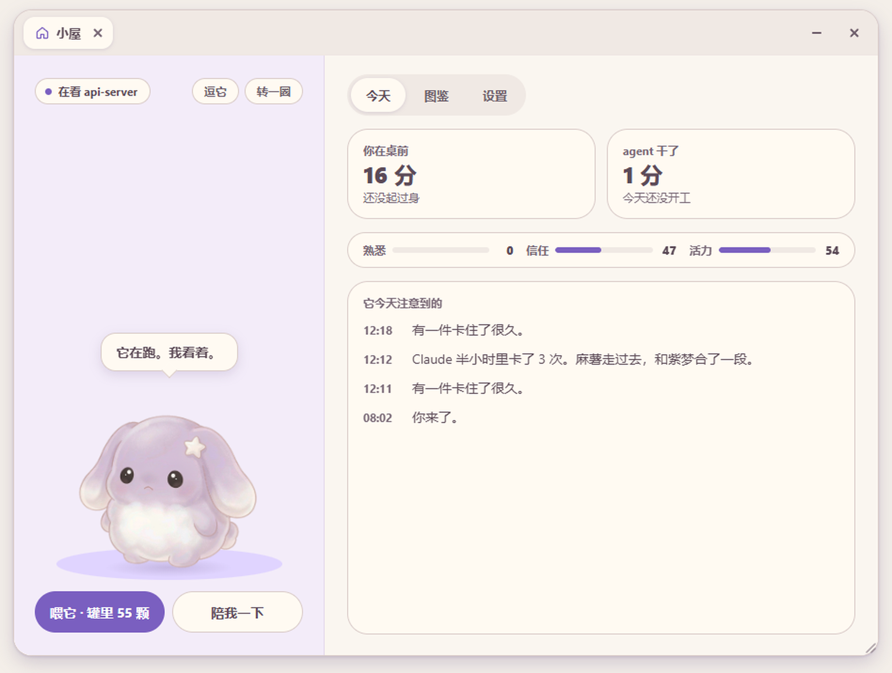
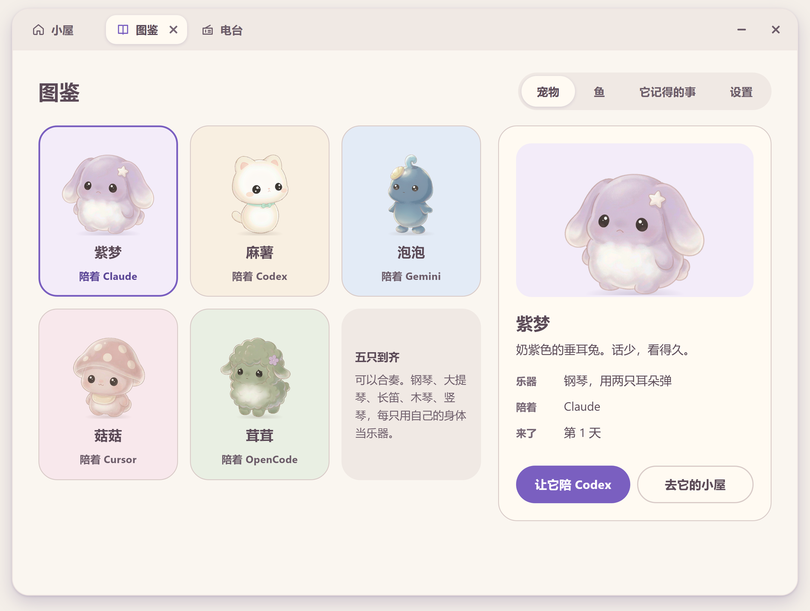

# 睿洱 RillBuddy

[English](README.md)

睿洱（RillBuddy，简称 Rill）在你的桌面上养宠物，让它们替你看着写代码的 agent：紫梦陪 Claude Code，麻薯陪 Codex，泡泡、菇菇、茸茸陪实验性支持的 Gemini CLI、Cursor、OpenCode。agent 在想、在动手、停下来等你、做完、出错，它都看在眼里，脸上和头顶的一句话会告诉你。它也看着你：坐久了、熬夜了、agent 连着卡住了，它会自己做点什么——跳一段舞、用自己的乐器奏一段、带你做一组提肛。没有 agent 在跑的时候，桌面上留一只紫梦。

纯本地运行，只支持 Windows 10/11。技术栈：Rust、Tauri 2、TypeScript/Canvas。



## 目录

- [它做什么](#它做什么)
- [快速开始](#快速开始)
- [使用](#使用)
- [配置](#配置)
- [从源码构建](#从源码构建)
- [目录结构](#目录结构)
- [隐私与安全](#隐私与安全)
- [常见问题](#常见问题)
- [许可证与素材](#许可证与素材)

## 它做什么

### 替你看着 agent

- **每个 agent 一只**，各不相同：Claude Code 是紫梦，Codex 是麻薯，Gemini CLI 是泡泡，Cursor 是菇菇，OpenCode 是茸茸（在图鉴里可以换）。脚下的标签写着是谁、在看哪个项目（`Claude · my-project`）；同一个 agent 开了几个会话，角上会有个数字。agent 的最后一个会话关掉，它的宠物就回家；一个 agent 都没开时，桌面上只有紫梦。
- **状态看脸**：干活时它看着，做完跳一下，出错皱眉，没活时犯困，睡着了就是睡着了。
- **等你的时候最显眼**：agent 停下来等你回话或批准，它马上抬头，头顶是一条珊瑚色的「等你呢。」，并响两个钢琴音。整个应用里只有这件事用这个颜色。
- **悬停 1 秒**看会话卡片：项目、状态、已经跑了多久、最近在用的工具。**双击**把那个会话的终端或 IDE 调到前台。卡片放在宠物上方，上面放不下就放到旁边，不会盖住宠物。
- **手上的事**：右键「陪我一下 → 记一件事」，在它头顶的气泡里写一行，回车记下；选中一段字按 `Ctrl+Alt+N`，就从那段字开始写。有事在手上时它身上别着一张纸条（不显示数字）。悬停卡片里会话下面列着这些事，点圆圈勾掉，它把那张纸揉成团吃掉；再点一次放回手上。写「等 Claude 做完…」的那件，等 Claude 这轮停下来、你又在电脑前时，由 Claude 的宠物提一句，点「好」到它的窗口去。agent 收工时说的「下一步：…」那一行会自己落成一张纸条（每个 agent 最多同时留 4 张），它回复里的其他内容不读。前一天没做完的，第二天早上和夜里整理的那句话一起说。
- **在宠物上批准权限**（可选，默认关）：Claude Code 要权限时，宠物上方弹出一张卡片，点「允许」或「拒绝」，不用切回终端。见[在宠物上批准权限](#在宠物上批准权限)。
- **额度**：右键菜单的「更多」里能看 Codex 的 5 小时 / 每周额度，Claude Code 的接上状态栏后也能看。用到 90% 时它会说一声。

### 也看着你

它只看一件关于你的事：距离上一次碰键盘或鼠标过了多久（不看你按了什么、屏幕上是什么）。由此它认得出几种情况，每种只回应一个动作，并且先说出它看到了什么：

| 它看到 | 它做 |
|---|---|
| 你连续坐了 90 分钟（下午 1–4 点是 60 分钟） | 跳一段舞，或者转过身带你做一组提肛，两样轮着来 |
| 夜里 11 点以后你还坐着 | 用自己的乐器奏一段 |
| 半小时里 agent 卡住了 3 次 | 那个 agent 的宠物奏一段 |
| 一个 agent 等了你 3 分钟，而你就在桌前 | 另一只走过去告诉你 |
| 一件跑了 15 分钟以上的活做完了 | 跳一段舞 |
| 你离开 20 分钟以上再回来，期间有活做完或卡住 | 告诉你发生了什么 |
| agent 一件活跑了 8 分钟以上，你停下手在等它 | 问要不要听电台；点「好」，从常听的电台里放一个 |
| 夜里 10 点以后你坐了半小时 | 问你要不要放点安静的；点「好」就从「安静的」里放 |
| agent 一个月以前的旧会话超过 1 GB（一周最多一次） | 问要不要整理储物间；点「好」，打开储物间 |
| 切到桌面时，有几个图标不在列里（一天最多一次） | 问要不要清扫桌面；点「好」，它骑扫帚过去，把图标扫回列中，再回到原处。完成后的气泡上有「放回原处」，可以撤销 |

清扫桌面只改变图标的位置，不移动、不改动文件。已在列中的图标保持不动，不在列中的依次放进后面的空位；大部分图标都不在列中时，按类型整体重排（系统图标和快捷方式保持原有顺序，文件按名称）。桌面图标已隐藏、或开启了「自动排列图标」时，不会清扫。

带「好」「不用」的是它在问，不会自己放出声音；电台已经在放、或者开着「安静一会儿」时它不问，问过一次几个小时内不再问。

两次之间至少隔 10 分钟。专注模式下、把「话多话少」调成安静时，它什么都不主动做。点它一下就停。

声音是真乐器的采样，每只有自己的乐器和自己的演法：紫梦用两只耳朵弹一排浮着的琴键；麻薯用尾巴当弓拉大提琴；泡泡横着吹一支长笛，每个音从笛尾冒出一个泡泡；菇菇用两根琴槌敲一架小木琴，敲到哪块哪块亮，菌盖上的斑点跟着亮；茸茸用靠琴那侧的耳朵拨立在身边的一架小竖琴，被拨的弦会抖，音符从琴上飘出来。舞各有九个舞步，包括转过身摇尾巴。

### 几只在一起

两个以上的 agent 同时开着，桌面上就有几只，这些时刻它们一起过：

- **第一天**：一只奏琴时，离它最近的那只走过去，其余的在原地听。小屋的日记里会记一句新来的那只来了。
- **从它们一起待过的第二天起**：一只奏琴，一只走过去，在场的都用自己的乐器合进来——五只的谱子是同一首曲子的五个声部，两只是二重奏，五只到齐是五重奏；跳舞也一起跳。
- **替对方叫你**：一个 agent 停下来等你超过 3 分钟，它自己的宠物已经在抬头看你了，另一只会走过去说一声。每次等待只说一次。
- **分一颗糖**：从第二天起，一个 agent 做完一件几分钟的活，另一个还在跑长活（或者刚卡住），做完的那只会走过去，从糖罐里拿一颗递给它。罐里真的少一颗，飞进嘴里的就是那一种；罐里最后一颗总留给你。40 分钟最多一次。
- **一起做完，碰一下**：两个 agent 前后一分半钟内做完，后做完的那只走过去，两只一起跳一下、碰一碰。
- **闲下来说两句**：大家都没活、安静了十来分钟，一只会走到另一只旁边，各说一句，各有各的说法：光、外面的声音、糖罐、跑调的琴、挂在屏幕边上的事。不出声的气泡，一个半小时最多一次；说了什么记在小屋的日记里。
- 走过去的那只，曲终自己走回原位。等你回话的那只不参加，睡着的那只不叫醒。
- **拖着主宠走**：按住紫梦（陪 Claude Code 的那只）拖动，其余的保持各自的位置跟着一起走，松手一起落地；拖别的宠物只动它自己。

右键菜单里手动点「弹首曲子」（按乐器是拉、吹、敲、拨）「跳支舞」，也是同一套规矩。

### 每只都是一整套皮肤

宠物不只是换个形象。从哪只打开的窗口，就穿哪只的皮肤：小屋、右键菜单、信纸、电台、批准卡片的颜色，信封上的印记，等你时的那两个音（用它自己的乐器），以及它说话的口吻——紫梦话少，只说看到的；麻薯黏人，会说自己当时待在哪儿。不属于任何一只的窗口（托盘、图鉴、日报）跟着陪 Claude Code 的那只。在图鉴里可以换谁陪哪个 agent。换了谁陪哪个 agent，已经打开的页面会跟着换肤。

### 小屋、信和其他

这些页面都开在**同一个窗口**里，各占一个标签：点一个功能就多一个标签，标签可以关掉。窗口的边框是自己画的，颜色跟着当前标签那只宠物的皮肤。关窗口只是把它收起来，标签还在，电台也接着放；关掉电台的标签才停。右下角可以拖着放大，双击标签栏空白处铺满屏幕。

- **小屋**：它坐着的地方。左边是它和它正在说的话，右边是今天：你在桌前多久、中间起身几次，agent 干了多久、跑了几轮、卡住几次，以及「它今天注意到的」——它每次主动做事都会记一条。小屋里可以和它玩：它的眼睛和头跟着你的指针；点它是戳一下，连戳几下它会把自己转晕；按住它左右拖，能把它转过去看背面；在它头上来回摸，它会眯起眼；「逗它」拿它自己的小挂件吊在指针上，整间小屋都是它的地方：它在地上跑着追，挂件到了头顶就蹲一下跳起来够，在空中咬住了就不松口，你可以拎着它晃，过一会儿它才松口落地；举得太高它跳不到，会告诉你（每只跳的高度不一样，麻薯最高，泡泡最矮）；「转一圈」让它原地转一圈；「接糖」是这里唯一的小游戏：30 秒里，图鉴里的各种糖从小屋上方飘下来，它跟着你的指针跑，点一下跳，落进嘴里的就吃掉。一轮接住 20 颗，罐里多一颗（一天最多两颗）。
- **喂它糖果**：它们吃糖果和果子，都是挣来的，存在糖罐里。来的是哪一种看时候：agent 每做完一轮得一颗（失败只有一张空糖纸）；早上、午后、夜里各有只在那时才有的，四季各有一种；没有 agent 的时候靠你自己——跟着它把一组提肛做完得一颗话梅，坐了半小时以上起身歇一会儿再回来得一片薄荷叶，这样挣的每天最多 6 颗。罐空了，喂它的按钮会告诉你怎么挣。喂它，它会回你一句话，偶尔说一句心里话。
- **来信**：信写的是你这个人，不是你做了什么。这些日子它从你的作息里慢慢看出你是什么样的人：卡住了不出声、自己扛；最安静的时间留给夜里；答应自己的事总往后排；做完一件从不停下来看它……信就写它看懂的这一点，和它对此的感受。写信总有个由头：卡了很久终于过去、连着几晚走得很晚、离开几天又回来、一件做了很久的事安静下来、替你拿了好些天的纸条被勾掉、比往常满得多的一天、认识你一个星期、一个月、一个季节，偶尔什么事也没有。信里没有数字、钟点和你在做的事的名字，不夸你，也不劝你。四天最多一封，没拆的信在就不写新的，同一件事不写第二次。
- **图鉴**：五只宠物和各自的乐器，谁陪哪个 agent 在这里换；遇到过的糖果（22 种，没遇到的会提示什么时候才有）、它记得的事（跨天的日记）、设置。
- **日报**：一张卡片，可以复制成图片。下班时间（默认 18:00）当天有活就自己弹出来；平时点小屋里「agent 的一天」那张卡打开。
- **电台**：全世界的电台，按常听的、提神的、安静的、相声、世界分。它陪你听，会说它知道的事（「这个台，第一次听。」）。
- **储物间**（在设置的「语言与接入」里）：你的 agent 在这台机器上都堆了什么。一是磁盘上的会话记录：Codex 一条都不删（天天用的机器上很容易到几个 GB），Claude Code 一个月后会自己清。超过 30 天的可以一键装进睿洱文件夹里的一个箱子（先检查箱子再移走原文件，最近 30 天的不碰），随时一键放回，日期不变。二是每开一个会话、你还没开口它就先读进去的：家目录和项目各级文件夹里的 CLAUDE.md / AGENTS.md、记忆索引、启动钩子塞进来的文字、列给它的技能、它要连的 MCP 服务器，各自大约多少 token，最近一个月从没用过的会标出来。没用过的技能可以在这里收进储物间（也能放回）；其余的给出改法和命令。全部在本机清点，不上传、不花 token。旧会话超过 1 GB 时，宠物一周最多提一次。
- **虫子**：agent 的工具失败时，屏幕底边会掉下虫子。宠物会自己沿着屏幕底边跑过去扑掉，你也可以抢先点。连着失败三次会来一只大的，把那只宠物压住动不了；这时其他在场的宠物会跑过来，站在大虫另一边一下下帮忙拍（在另一块屏幕上的会走过来，拍完再走回去），你点也算，拍掉它就能动了。



### 不打扰

- 老板键（`Ctrl+Alt+H`）一键全部隐藏并静音；前台全屏、开会共享屏幕时自动隐身。
- 「安静一会儿」（专注模式，`Ctrl+Alt+F`）只留状态和「等你」的提醒。
- 只在 `127.0.0.1` 上用 token 通信。会联网的只有三件事，见[隐私与安全](#隐私与安全)：电台、下载本地语言模型、以及设了 `ANTHROPIC_API_KEY` 时的写信。

## 快速开始

### 1. 安装

1. 从 Releases 页面下载 `RillBuddy_<版本>_x64-setup.exe`，或者[自己构建](#从源码构建)。
2. 运行安装包。装到当前用户目录，不需要管理员权限。安装包还没有代码签名，SmartScreen 可能会拦一下，见[常见问题](#常见问题)。
3. 装好后睿洱会自己启动，并默认开机自启（设置 →「这台电脑上」→ 开机自启 可以关掉）。
4. 首次启动，紫梦把 agent 的几种状态演一遍给你看，同一页上就有「接入」按钮。想再看一遍：`/pet tour`。

### 2. 接入 Claude Code

托盘 →「设置…」→「语言与接入」→ 接入 agent → **Claude Code…**

它会替你运行 `claude plugin marketplace add` 和 `claude plugin install rillbuddy@rillbuddy`（需要已经装了 Claude Code 命令行版）。装完重开 Claude Code。

手动操作的话，在普通终端里执行：

```
claude plugin marketplace add /path/to/rillbuddy
claude plugin install rillbuddy@rillbuddy
```

用安装包安装时，marketplace 在 `rillbuddy.exe` 旁边的 `plugin` 文件夹里。Windows 上路径也要用正斜杠（`C:/path/to/rillbuddy`）；在 Claude Code 交互界面里执行 `/plugin marketplace add` 时，反斜杠路径会没有响应。

### 3. 接入 Codex

托盘 →「设置…」→「语言与接入」→ 接入 agent → **Codex…**

它会在 Codex 的 `hooks.json` 里追加睿洱的 hook，原有的 hook 保留，写入前先备份。

**最后还有一步必须手动做：**在终端运行 `codex`，输入 `/hooks`，把睿洱的 hook 标记为信任。Codex 只运行信任过的 hook。ChatGPT / Codex 桌面应用里没有 `/hooks` 命令，但两者共用同一个配置目录，在命令行里信任过就行。

两个「接入」都会先弹窗说明要改什么，点「接入」才执行。

手动操作：

```
rillbuddy-emit --install codex
```

- 写到 `$CODEX_HOME/hooks.json`，没设 `CODEX_HOME` 时写到 `~/.codex/hooks.json`。也可以用 `--codex-home <目录>` 指定。
- 你原有的 hook 原样保留，睿洱的 hook 追加在每个事件的最后。
- 写入前备份为 `hooks.json.rillbuddy-bak`。
- emitter 会复制到 `~/.rillbuddy/bin/`，以后挪动仓库不影响。
- 不确定 Codex 用的是哪个配置目录时（比如设了 `CODEX_HOME`，同时也在用 `~/.codex`），两个都装：再执行一次，加上 `--codex-home %USERPROFILE%\.codex`。
- 卸载：`rillbuddy-emit --uninstall codex`

### 4. 其他 agent（实验性）

Gemini CLI、Cursor、OpenCode 也可以各有一只。在图鉴的「设置」页 → 其他 agent 里点对应的按钮，或者手动：

```
rillbuddy-emit --install gemini      # 在 ~/.gemini/settings.json 里追加 hook
rillbuddy-emit --install cursor      # 在 ~/.cursor/hooks.json 里追加 hook
rillbuddy-emit --install opencode    # 写一个插件到 ~/.config/opencode/plugins/rillbuddy.js
```

把 `--install` 换成 `--uninstall` 即可移除；配置目录不在默认位置时加 `--config-dir <目录>`。原有的 hook 都保留，写入前先备份。

- Cursor 没有「正在等用户批准」这个 hook 事件，所以它那只不会叫你。
- **这三个适配是按各家的官方文档写的，还没有在真实的 Gemini CLI、Cursor、OpenCode 上验证过。**字段对不上时，把 [`adapters/`](adapters/) 里对应的 `mapping.yaml` 复制到 `~/.rillbuddy/adapters/<名字>.yaml` 修改即可生效，不用重新编译；也欢迎提 issue。
- Cursor 默认还会运行 Claude Code 的 hook；睿洱认得出这种情况，不会把 Cursor 的会话算到 Claude Code 那只头上，Cursor 要单独接入。

完成。在任意一个 agent 里开个会话，对应的那只就动起来了。

## 使用

### 鼠标操作

| 操作 | 效果 |
|---|---|
| 单击 | 捏一下。它在表演时，单击是「够了」 |
| 在头上来回摸 3 次 | 它高兴一下 |
| 5 秒内单击超过 12 次 | 它说「够了。」跳开，一分钟内不理你 |
| 按住拖动 | 移动；松手时带着速度甩出去，会反弹，撞得太狠会晕。甩得够快、撞上屏幕的左右边或顶边，它会挂在那儿：靠在侧边慢慢往下滑，或者吊在顶边晃。过一阵累了、被你点一下、被喂了糖变重、或者它的 agent 在等你，它就滑下来，落地后自己走回被拿起来之前的位置 |
| 双击 | 把会话所在的终端或 IDE 调到前台（先去等你的那个） |
| 悬停 1 秒 | 会话卡片 |
| 右键 | 菜单 |

宠物会落在屏幕底边或普通窗口的标题栏上，脚下的窗口被移走或关掉时会掉下来。身体以外的透明区域点击穿透，不挡鼠标。

### 右键菜单

右键宠物，旁边弹出一张卡片。顶上是它的名字、它替哪个 agent 看着、在看哪个项目、今天 agent 一共干了多久。下面：

- **陪我一下**：跳支舞 · 弹首曲子（麻薯是「拉首曲子」）· 放电台 · 做一组提肛 · 记一件事
- **喂它**：后面写着罐里还有几颗
- **有一封信**：有信的时候才出现
- **小屋**
- **安静一会儿**：专注模式的开关
- **更多**：多喂几颗 · 用量或重置卡 · 隐藏。（图鉴、日报这些页面都在它的小屋里，开关在托盘里。）

### 托盘面板

点托盘图标。上面是在场的宠物和各自的状态；三个开关：**安静一会儿**、**它自己会做事**、**声音**；大小三档；**打开小屋**、**都藏起来**（老板键）、退出。下面只有一行**设置…**，其余的都在设置里（话多话少、提肛、语言、接入 agent、储物间、开机自启、本地语言模型、数据文件夹）。托盘和右键菜单不再给新功能单独开位置：新功能要么自己发生、由宠物在合适的时候提起，要么放进已有的页面。

切换开关时面板不会关闭；点面板外面或按 Esc 关闭。

### `/pet` 命令（Claude Code）

| 命令 | 作用 |
|---|---|
| `/pet show`、`/pet hide` | 显示、隐藏宠物 |
| `/pet stats` | 查看各会话状态 |
| `/pet focus [on/off]` | 专注模式 |
| `/pet size s/m/l` | 宠物大小 |
| `/pet lang auto/zh/en` | 界面语言 |
| `/pet kegel` | 马上跟它做一组提肛 |
| `/pet radio` | 打开电台 |
| `/pet moment [share\|bump\|chat\|tidy\|stow]` | 马上演一个宠物之间的小场面（分糖、碰一下、说两句），要两只都在；`tidy` 让一只宠物询问是否清扫桌面；`stow` 让它询问是否边扫边把很久没碰的文件收进「桌面收纳」 |
| `/pet report` | 打开今日报告 |
| `/pet menu` | 打开右键菜单 |
| `/pet tour` | 它把 agent 的几种状态演一遍 |

Codex 没有对应的命令，用托盘、右键菜单或图鉴操作。

### 设置

图鉴 →「设置」页（托盘 →「设置…」）：大小、话多话少、安静一会儿、声音、提肛每次几下、界面语言、在宠物上批准权限、接入各个 agent、接上 Claude Code 用量。改了立刻生效，写进 `config.yaml`。

### 在宠物上批准权限

默认关闭。在设置里打开之后：

- Claude Code 每次要权限，宠物上方弹出一张卡片：工具名、它自己写的一句说明、要运行的命令（或要改的文件、要访问的地址），三个按钮：**允许**、**拒绝**、**回终端决定**。只管这一次，不会改你的权限规则。
- 卡片不抢焦点，你手上的窗口不会被打断。多个请求会排队，卡片右上角显示还有几个。
- **代价**：打开以后，终端里自己的确认框要等这张卡片。你不点的话，等到设定的时间（15 / 30 / 60 秒，默认 30）才回到终端里照常问你；想马上回终端，点「回终端决定」。
- 全屏、共享屏幕、按了老板键时不弹卡片，直接回终端问。
- 要显示的命令内容会交给本机的睿洱（平时不转发这些），只用来显示这张卡片，不保存。
- 只支持 Claude Code。Codex 的 hook 没有办法把答案带回去。
- 关着的时候和以前完全一样：hook 立刻返回，不等任何东西。

### 快捷键

| 默认 | 作用 |
|---|---|
| `Ctrl+Alt+H` | 老板键：所有宠物和覆盖层立即隐藏并静音；再按一次，它从下面探头回来 |
| `Ctrl+Alt+F` | 安静一会儿（专注模式）：只留状态和等你的提醒 |
| `Ctrl+Alt+N` | 记一件事；先选中一段字，就从那段字开始写（通过系统的辅助功能接口读选区，不碰剪贴板，密码框不读） |

在 `config.yaml` 的 `hotkeys` 里修改，重启后生效。

### 自动隐身

- **全屏**：前台窗口全屏时（看视频、放幻灯片）自动隐藏，退出全屏 3 秒后恢复。
- **共享屏幕**：检测到腾讯会议、飞书、钉钉、Zoom、Teams 等的「正在共享」工具条窗口时自动隐藏。识别不了你用的会议软件时，在 `config.yaml` 的 `meeting.share_windows` 里加工具条窗口标题或类名的关键词。

## 配置

运行时数据在 `~/.rillbuddy/`，可以用环境变量 `RILLBUDDY_HOME` 改到别处。设置 →「语言与接入」→ **编辑配置…** 打开 `config.yaml`，保存后自动生效。

```yaml
language: auto           # 界面语言：auto（跟随系统）| zh | en

companions:              # 谁陪哪个 agent（图鉴里也能换）：zimeng | mashu | paopao | gugu | rongrong
  claude-code: zimeng
  codex: mashu
  gemini: paopao
  cursor: gugu
  opencode: rongrong

features:
  focus_mode: false      # 安静一会儿
  sounds: true           # 琴声和提示音
  size: m                # s | m | l（0.75 / 1 / 1.35 倍）
  kegel_reps: 10         # 一组提肛做几下（收紧 3 秒、放松 3 秒）
  chatter: normal        # 它自己说话、做事的多少：quiet | normal | lively
  approve: false         # 在宠物上方的卡片里允许 / 拒绝 Claude Code 的权限请求
  approve_wait_s: 30     # 卡片等你多久（秒），之后回到终端里问

# meeting:
#   share_windows: ["正在共享"]   # 识别会议软件「正在共享」工具条的额外关键词

hotkeys:
  boss_key: Ctrl+Alt+H
  focus_toggle: Ctrl+Alt+F
  note: Ctrl+Alt+N
```

设置页和 `/pet` 命令会改写这个文件：你自己加的配置项会保留，**注释不会保留**（YAML 库的限制）。写入前会先校验，不合法的修改不会落盘。旧版本留下的配置项（路由模式、宠物包等）会被忽略，不会报错。

### 数据目录

| 路径 | 内容 |
|---|---|
| `config.yaml` | 配置 |
| `token`、`port` | 本地接口的凭据和端口 |
| `spool/` | 睿洱没运行时暂存的事件 |
| `windows.json` | 宠物位置（显示器拔掉后回到主屏右下角） |
| `rillbuddy.db` | 回合记录、糖罐、拍虫记录、日记、关系（SQLite） |
| `balance.yaml`、`treats.yaml` | 可选：覆盖内置的数值和糖果的种类（名字、样子、什么时候出现），只写要改的键 |
| `interactions/*.yaml` | 可选：自己的互动规则；同 id 覆盖内置规则，`enabled: false` 可关闭 |
| `bin/` | 安装到 Codex 的 emitter |
| `logs/petd.log` | 日志 |

内置默认值在 [`crates/petd/assets/`](crates/petd/assets/)，可用字段写在文件注释里。读过的信存在这台机器上应用自己的网页存储里。

## 从源码构建

需要 Rust 1.88+、Node 18+、WebView2（Windows 10/11 自带）。

```bash
cd app && npm install && cd ..
node tools/build.mjs            # release；加 --debug 编得更快
```

这一步会构建 `target/release/rillbuddy.exe`，并把 `rillbuddy-emit` 复制到 `adapters/claude-code/bin/`。

出安装包：`node tools/build.mjs --bundle`，生成 `target/release/bundle/nsis/RillBuddy_<版本>_x64-setup.exe`。安装包里带着 Claude Code 插件和 emitter。第一次构建时 Tauri 会下载 NSIS。

npm 里的 `@tauri-apps/api` 版本要和 Rust 的 Tauri 版本保持同一个小版本（目前都是 2.11），否则 `tauri build` 会拒绝打包。

### 从源码运行

1. 手动运行一次 `rillbuddy.exe`。它会把自己的路径写进 `~/.rillbuddy/petd_path`，以后 emitter 发现它不在时会自动拉起。
2. 以仓库作为 marketplace 接入 Claude Code：
   ```
   claude plugin marketplace add /path/to/rillbuddy
   claude plugin install rillbuddy@rillbuddy
   ```
3. 接入 Codex：`adapters\claude-code\bin\rillbuddy-emit.exe --install codex`，然后在 `codex` 里用 `/hooks` 信任。

Claude Code 会把插件复制到 `~/.claude/plugins/cache/`。重新构建后要把 `adapters/claude-code/.claude-plugin/plugin.json` 的版本号改掉，更新插件，然后重开 Claude Code：

```
claude plugin marketplace update rillbuddy
claude plugin update rillbuddy@rillbuddy
```

测试、调试方法和贡献规范见 [CONTRIBUTING.md](CONTRIBUTING.md)；实现说明见 [docs/implementation-notes.md](docs/implementation-notes.md)。

## 目录结构

```
crates/emit/              hook 发射器（Rust，单文件可执行），含各 agent 的安装器
crates/petd/              守护进程核心库：会话状态机、每个 agent 一只宠物、世界层（糖果、虫子）、
                          五只宠物和谁陪谁（cast.rs）、它们自己会做的事和两只的联动（think.rs）、
                          各自的口吻（voice.rs）、关系与信（bond.rs）、配置、HTTP/WS、SQLite
crates/petd/assets/       内置的 balance.yaml、treats.yaml、interactions.yaml、bond.yaml
app/                      Tauri 2 外壳 + TypeScript/Canvas 页面
  index.html              宠物窗口（每只一个）
  src/rig/                拆层绑定：rig.js（长耳兔和直立身体两类的姿态、表情、舞步）、perform.js（五种乐器的谱子和跳舞）
  src/skin.ts voice.ts    每只宠物的一整套皮肤，和它在窗口里说的话
  public/rig/<宠物>/      每只宠物的图层（zimeng、mashu、paopao、gugu、rongrong）
  public/audio/<乐器>/    乐器采样（piano、cello、flute、xylophone、harp）
  menu.html tray.html     右键菜单、托盘面板
  shell.html              所有页面所在的那个窗口：自绘的边框和标签栏，每个页面是一个标签
  room.html               小屋
  gallery.html            图鉴（宠物、糖果、它记得的事、设置）
  letter.html radio.html report.html welcome.html
  card.html approve.html  悬停会话卡片、权限卡片
  overlay.html            覆盖层（每个显示器一个）：虫子
adapters/claude-code/     Claude Code 插件：hooks/hooks.json、commands/pet.md、bin/
adapters/codex/ gemini/ cursor/ opencode/   各 agent 的映射表
design/pet-art/           五只宠物的原画、切层脚本和预览页（不进安装包）
tools/build.mjs           构建脚本
docs/                     实现说明、截图
```

工作原理：agent 的每个 hook 都会运行 `rillbuddy-emit`，它把一个小事件发给本地守护进程（`petd`，跑在 App 里面）后立刻退出——总耗时 ≤ 300 ms（唯一的例外是你自己打开「在宠物上批准权限」之后的权限请求，它会等你在卡片上点）。守护进程不在时事件先存进 `spool/`，下次启动补上。页面通过本地 HTTP/WebSocket 读状态。

## 隐私与安全

- **只在本机。**守护进程只监听 `127.0.0.1`（默认端口 47321，被占用时随机选一个空闲端口），每个请求都要带 `~/.rillbuddy/token` 里的 token。会联网的只有三件事：（1）打开电台时，从 [Radio Browser](https://www.radio-browser.info/) 读取电台目录并播放你选的台；（2）在托盘里点了「宠物的语言模型」时，从 Hugging Face 下载一个约 390 MB 的本地模型，用来写信；（3）写信时，如果环境变量 `ANTHROPIC_API_KEY` 存在，信交给 Anthropic 的接口写，发过去的是宠物的名字和性子、为什么写这封信（比如「前两天下午，有一件事卡了很久，最后过去了」），以及它看懂的你（比如「卡住了宁愿自己再试一次」），不含代码、文件名、项目名、时间和你写的纸条。没有这个变量时用本地模型，或者用为每种由头和每种看法写好的信拼成一封，不联网。
- **关于你，它只读一个数。**「你坐了多久」来自系统的「距离上次键鼠输入多少秒」。它不读按键，不截屏，不看窗口内容。
- **事件只带必要信息。**hook 只把宠物需要的东西交给守护进程：会话 id、事件类型、会话的工作目录、工具名、被修改文件的文件名和 agent 进程号。提示词、文件内容、工具输出都不会转发。只有一个例外，而且由你亲手打开：「在宠物上批准权限」会把要批准的那条命令交给本机的睿洱用来显示卡片，不保存。另外，一轮结束时，hook 会在 agent 最后那段回复里找写着「下一步：…」的那一行，只把这一行交给守护进程，记进「手上的事」；回复的其余部分不转发。
- **选中的字只在你按键时读。**按 `Ctrl+Alt+N` 时，通过系统的辅助功能接口读一次当前选中的文字，用来开头那件事；不碰剪贴板，不模拟按键，密码框不读。
- **hook 只追加，不替换。**Claude Code 这边是一个普通插件。Codex、Gemini CLI、Cursor 那边，睿洱把自己的 hook 追加在你的后面，写入前先备份；OpenCode 那边是单独一个插件文件。
- **Claude Code 用量只读。**用量数字来自 Claude Code 交给状态栏命令的数据，由你点「接上」之后才读取；睿洱不登录你的账号，也不联网查询。
- **Codex 额度只读。**额度显示读取的是 Codex 自己的会话日志，不做任何修改。睿洱永远不会替你使用重置卡。
- **本机系统信息。**为了检测关掉的会话、跳转到终端、全屏和共享屏幕时隐身，App 会读取本机的进程列表和窗口标题。这些信息不保存，也不发往任何地方。

## 常见问题

**Windows SmartScreen 拦截了安装包。**
安装包还没有代码签名。点「更多信息 → 仍要运行」，或者自己构建安装包。

**Codex 那只一直不动。**
Codex 只运行信任过的 hook。在终端运行 `codex`，输入 `/hooks`，把睿洱的 hook 标记为信任。如果你用了不止一个 Codex 配置目录，每个都要装（见[接入 Codex](#3-接入-codex)）。

**重新构建后 Claude Code 还在跑旧的 emitter。**
Claude Code 运行的是缓存里的插件副本。改掉插件版本号，执行 `claude plugin marketplace update rillbuddy` 和 `claude plugin update rillbuddy@rillbuddy`（或者再点一次 接入 → Claude，已安装时会自动更新），然后重开 Claude Code。

**从 0.1.33 或更早的版本升级。**
以前程序叫 `familiar.exe`，数据在 `~/.familiar`，Claude Code 插件叫 `familiar@familiar`。新版第一次启动时会把数据搬到 `~/.rillbuddy`，原来的位置留一个指过去的链接，所以旧的 hook 照常能用。之后宠物会问一句要不要把 Claude Code 里的接入换成新名字，点「好」就换，重开 Claude Code 后生效。Codex 的 hook 不会自动改（改了要重新信任），想换的话在设置里再点一次接入 Codex。等没有任何地方再用旧路径，那个链接会自己删掉。

**宠物不见了。**
依次检查：是不是按了老板键（`Ctrl+Alt+H`）；前台是不是有全屏窗口；会议软件是不是在共享屏幕；是不是藏起来了（托盘 → 都叫出来，或 `/pet show`）。

**它为什么不自己做事。**
看一下是不是开着「安静一会儿」，或者把「它自己会做事」关了。另外它只在你确实坐了那么久之后才动，两次之间至少隔十分钟。

**共享屏幕时没有隐身。**
在 `config.yaml` 的 `meeting.share_windows` 里加上会议软件「正在共享」工具条的窗口标题或类名关键词。

**双击跳不到具体的标签页。**
Windows Terminal 只能切到窗口，切不到具体标签页。

**日志在哪？**
`~/.rillbuddy/logs/petd.log`。

## 许可证与素材

代码：[MIT](LICENSE)。

- **钢琴采样**：Salamander Grand Piano（Alexander Holm），[CC BY 3.0](https://creativecommons.org/licenses/by/3.0/)，见 [`app/public/audio/piano/LICENSE.txt`](app/public/audio/piano/LICENSE.txt)。
- **大提琴采样**：「Real Cello Notes」（flcellogrl，Freesound），取自 Nicholaus Brosowsky 的 tonejs-instruments 整理版，[CC BY 3.0](https://creativecommons.org/licenses/by/3.0/)，见 [`app/public/audio/cello/LICENSE.txt`](app/public/audio/cello/LICENSE.txt)。
- **长笛、木琴、竖琴采样**：Versilian Studios Chamber Orchestra 2 社区版（VSCO 2 CE，CC0），取自同一个 tonejs-instruments 整理版（[CC BY 3.0](https://creativecommons.org/licenses/by/3.0/)），见 `app/public/audio/flute/`、`xylophone/`、`harp/` 各自的 `LICENSE.txt`。
- **宠物形象**：紫梦、麻薯、泡泡、菇菇、茸茸是本项目的原创角色。
- **电台目录**：[Radio Browser](https://www.radio-browser.info/)，声音直接来自各电台。
