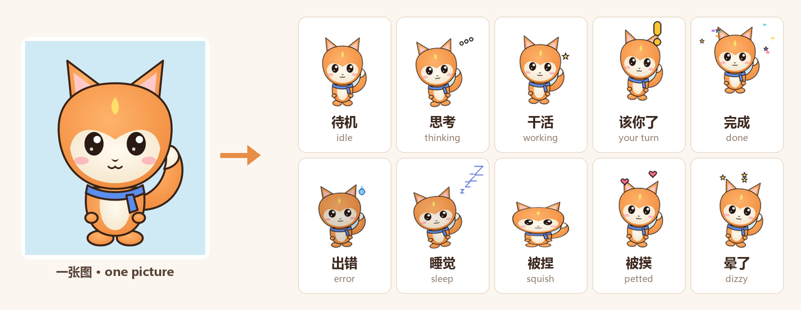

# Make your own pet from one picture

[中文](make-a-pet.zh-CN.md)

One character picture is enough for a Familiar pet that breathes, tilts its head while thinking, hops up when your agent needs you, throws confetti when a turn is done, sweats on errors, dozes off when idle, and reacts when you drag or pet it. It all happens in the gallery with a few clicks, background removal included: nothing to install.

## Three steps

1. **Open the gallery**: right-click a pet → **Gallery** in the ring menu, or tray icon → Gallery.
2. **Click "Make a pet from a picture…"** and choose a picture, or just drag one into the gallery window. A live preview appears right away and cycles through all 16 actions; click an action to see it alone.
3. **Name it and click Install**, then choose **For Claude Code** or **For Codex**. It lives on your desktop now.

Not happy? Click **Cancel** or **Another picture**; nothing gets installed.

### What you can customize

| Option | What it does |
|---|---|
| Style | **Big-head chibi**: bigger head, shorter body, and the head wobbles like a bobblehead; **As is**: the original proportions. Photos and posters start as big-head chibi, drawings as is; switch any time and the preview updates |
| Name | Required; shown in the gallery and on the card |
| English name | Optional; used when the UI is in English |
| Size | Small / Medium / Large, the pet's default size on the desktop |
| Lines | Optional: what it says when you're needed, when it's done and on errors. Separate several with `/`, e.g. `Your turn! / Come take a look` |

To change it later, make it again with the same name; you'll be asked whether to replace it.

## Which pictures work best

- **Full body, facing the viewer** works best, filling most of the picture, at least 400 px tall. Half-body shots and portraits work too.
- **Any background**; the app removes it:
  - a transparent PNG is used as is;
  - a plain colour (green screen, white, …) is keyed out, which gives the cleanest edges;
  - a busy background (photos, posters) goes through a small built-in segmentation model. It runs on your computer inside the app; the picture is never uploaded.
- Not happy with the automatic cut-out? Click **Keep the background as a sticker** to turn the whole picture into a rounded sticker.

## Better looking: chibi-fy it with AI first

If your picture is a photo, a poster or a half-body shot, ask an AI to draw a **full-body chibi** first; the result looks much better. Any image model that takes a reference picture will do (ChatGPT, Gemini and others). Send it your picture with this prompt:

> Turn the character in the reference image into a cute chibi desktop-pet mascot. Full body, standing straight, facing the viewer, arms relaxed at the sides, feet visible at the bottom. Chibi proportions about 2.5 heads tall, big head, small body. Keep the character's identity: hair, eye color, face, outfit, colors and accessories. Clean cel-shaded cartoon style, bold dark outline, flat colors, game sprite look. Centered with empty margin around. Background: one solid flat pure green color (#00FF00), no gradient, no floor, no shadow, no other objects, no text.

Save the one you like and use it in the gallery. The green background is removed automatically.

## Advanced: real frame-by-frame animation

For real animation in every action (waving, jumping, sitting down to sleep), make a short image-to-video clip per action and pack them with [`tools/petgen`](../tools/petgen/README.md), then use **Import folder…** in the gallery. This route needs Python and ffmpeg; per-action prompts are in [`tools/petgen/prompts.md`](../tools/petgen/prompts.md).

`tools/petgen/build_pack.py --image picture.png` makes the same one-picture pack from the command line, handy for making many at once.

## FAQ

**Which actions are generated**: idle, thinking, working, your turn, done, error, sleep, wake, plus squish, petted, annoyed, walk, fall, dizzy, cheer and sulk for dragging and play. Everything else (fishing, for example) borrows idle, and the mini games still work.

**Too small or too big**: right-click the pet → Settings → size, or make it again with a bigger Size.

**Removing it**: the **Delete** button on its card in the gallery.

**Can I share it?** Click **Open pets folder** in the gallery, zip that pet's folder and send it; your friend installs it with **Import zip…**. A pack made from someone else's character is fine for personal use; sharing or redistributing it needs the rights holder's permission.
