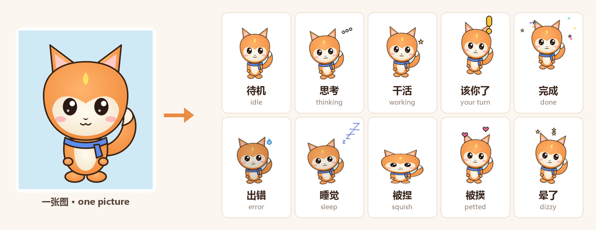

# 用一张图做你自己的桌宠

[English](make-a-pet.md)

只要一张角色图，就能在 Familiar 里做出一只会动的宠物：会呼吸、歪头想事情、跳起来提醒你、完成时撒彩带、出错时冒冷汗、困了打瞌睡，被拖拽、抚摸时也有反应。全部在图鉴里点几下完成，背景也会自动去掉，不用装任何东西。

## 三步做好

1. **打开图鉴**：右键宠物 → 环形菜单里的 **图鉴**，或者托盘图标 → 图鉴。
2. **点「用图片做宠物…」**，选一张图片，或者直接把图片拖进图鉴窗口。左边马上出现动画预览，会自动轮播 16 个动作，也可以点下面的动作单独看。
3. **填名字，点「安装」**，然后选 **给 Claude Code** 或 **给 Codex**。它就住进你的桌面了。

不满意就点 **取消** 或 **换一张图**，什么都不会装。

### 可以自定义的

| 选项 | 说明 |
|---|---|
| 名字 | 必填，显示在图鉴和卡片上 |
| 英文名 | 可选，界面切到英文时用 |
| 大小 | 小 / 中 / 大，宠物在桌面上的默认大小 |
| 台词 | 可选：需要你确认时、完成时、出错时各说什么，多句用 `/` 分开，比如 `该你啦！/ 过来看看` |

做好后想改，用同样的名字再做一次，会问你要不要覆盖。

## 什么样的图效果最好

- **全身、正面**的图效果最好，人物占画面大部分，高度至少 400 像素。半身照、头像也能用。
- **背景什么样都行**，App 会自动去掉：
  - 透明 PNG 直接用；
  - 纯色背景（绿幕、白底等）按颜色抠掉，边缘最干净；
  - 照片、海报这类杂乱背景，用内置的小型抠图模型自动抠出人物。模型就在 App 里，在你电脑上运行，图片不会上传到任何地方。
- 自动抠得不满意，可以点 **保留背景，做成贴纸**，把整张图做成一张圆角贴纸。

## 想要更好看：先让 AI 画成 Q 版

原图是真人照片、海报或半身像时，先让 AI 画一张 **Q 版全身立绘**，效果会好很多。任何能"参考图片出图"的模型都可以，例如 ChatGPT、Gemini、豆包、即梦等。把原图发给它，配上这段提示词：

> Turn the character in the reference image into a cute chibi desktop-pet mascot. Full body, standing straight, facing the viewer, arms relaxed at the sides, feet visible at the bottom. Chibi proportions about 2.5 heads tall, big head, small body. Keep the character's identity: hair, eye color, face, outfit, colors and accessories. Clean cel-shaded cartoon style, bold dark outline, flat colors, game sprite look. Centered with empty margin around. Background: one solid flat pure green color (#00FF00), no gradient, no floor, no shadow, no other objects, no text.

挑一张满意的保存下来，再用它在图鉴里做宠物。绿色背景会被自动抠掉。

## 进阶：逐帧真动画

想让每个动作都是真正的动画（举手招呼、跳起来、坐下睡觉），可以用图生视频模型给每个动作生成一段短视频，再用 [`tools/petgen`](../tools/petgen/README.md) 打包成宠物包，最后在图鉴里点 **导入文件夹…**。这条路线需要 Python 和 ffmpeg，适合愿意折腾的用户；每个动作的提示词见 [`tools/petgen/prompts.md`](../tools/petgen/prompts.md)。

`tools/petgen/build_pack.py --image 图片` 也能在命令行里用一张图生成宠物包，效果和图鉴里一样，适合批量制作。

## 常见问题

**哪些动作会自动生成**：待机、思考、干活、提醒、完成、出错、睡觉、醒来，以及拖拽和互动用的被捏、被摸、生气、走路、下落、晕了、欢呼、闹别扭。其余动作（比如钓鱼）会借用待机动作，小游戏照样能玩。

**宠物太小或太大**：右键宠物 → 设置里调整大小；或者重新做一次，把「大小」选大一点。

**怎么删掉**：图鉴里那张卡片右上角的 **删除**。

**能分享给别人吗**：图鉴里点 **打开宠物目录**，把那只宠物的文件夹压缩成 zip 发给朋友，对方用 **导入 zip…** 安装。用别人的角色做的宠物自己用没问题；分享或再发布需要版权方授权。
